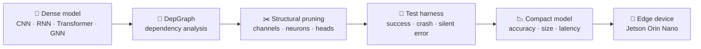

<div align="center">


<a href="https://git.io/typing-svg"></a>

<br/>

<a href="mailto:poorni.pathirage@gmail.com"></a>
<a href="https://www.linkedin.com/in/poornipathirage"></a>
<a href="https://github.com/poorniGimasha2003"></a>

</div>


## 🧠 Input Layer: About Me

```python
class Neuron:
    def __init__(self):
        self.name      = "Poorni Pathirage"
        self.role      = "Computer Engineering Undergraduate (3rd year)"
        self.campus    = "University of Sri Jayewardenepura, Sri Lanka"
        self.research  = "Structural pruning & model compression"
        self.interests = ["Deep Learning", "Edge AI", "NLP", "IoT for Healthcare"]
        self.building  = "BedSense, a smart bedsore detection system"

    def activation(self, problem):
        return "curiosity" if problem.is_hard else "let's ship it"
```

I'm fascinated by how networks of simple units can learn complex behaviour, and by how many of those units we can **remove** without losing what they learned. My current work focuses on making deep neural networks **smaller and faster** so they can run on real edge hardware.


## ⚡ Hidden Layers: What I'm Working On



> **Research question:** *Which architectures can DepGraph prune safely, where does it break, and how can we extend it to layers it doesn't support yet (like LSTM/GRU)?*


## 🎯 Output Layer: Projects

<details open>
<summary><b>✂️ Structural Pruning of Neural Networks: Evaluating & Extending DepGraph</b> &nbsp;<code>Oct 2026 – Present</code></summary>
<br/>

- Researching **structural pruning**, which removes whole channels, neurons and attention heads to compress deep networks for edge devices.
- Evaluating **DepGraph (CVPR 2023)** and the open-source **Torch-Pruning** library across CNN, RNN/LSTM, Transformer and Graph Neural Network architectures.
- Building an **automated PyTorch test harness** that records whether pruning succeeds, crashes, or silently produces incorrect outputs.
- Aiming to add pruning support for under-supported layers and **contribute it back to Torch-Pruning**, with fair comparisons on accuracy, model size and inference latency.

`Python` `PyTorch` `Torch-Pruning` `torchvision` `Hugging Face Transformers` `PyTorch Geometric`
</details>

<details>
<summary><b>🛒 End-to-End E-Commerce ML Pipeline</b> &nbsp;<code>Jul 2026</code></summary>
<br/>

- Complete ML pipeline on **~780,000 real transactions** (UCI Online Retail II), from data cleaning to an interactive dashboard.
- Customer segmentation with **RFM analysis + clustering**, and **churn prediction** using a time-based train/test split.
- **Apriori market-basket analysis** and a **PageRank co-purchase network** to surface high-influence products, deployed with Streamlit.

`Python` `pandas` `scikit-learn` `mlxtend` `NetworkX` `Streamlit`
</details>

<details>
<summary><b>🛏️ BedSense: Smart Bedsore Detection System</b> &nbsp;<code>Jan 2026 – Present</code></summary>
<br/>

- Came up with the original idea for a **sensor-based monitoring prototype** that detects pressure-related risks in bedridden patients.
- Designed the **software architecture**, integrated the database, and built the real-time monitoring interface.
- Worked with a multidisciplinary team to connect the software to **embedded hardware and IoT communication** workflows.

`ESP32` `MQTT` `Node.js` `React` `SQLite` `IoT`
</details>


## 🏆 Activations: Awards & Recognition

| | Achievement | Project |
|:-:|---|---|
| 🥇 | **Champions**, VERTEX 2025 Innovation Challenge (IEEE RAS, IIT) | IoT & Robotics |
| 🥈 | **1st Runner-Up**, Brainstorm 2026 (IEEE EMBS, University of Moratuwa) | BedSense |
| 🌍 | **Top 6 Finalist**, Hult Prize Sri Lanka Nationals 2026 | BedSense |
| 📡 | **Finalist**, SLIoT Challenge 2026 (University of Moratuwa, SLT-Mobitel, IESL) | BedSense |
| 💡 | **Winner**, IdeaPulse 2.0 Inter-Faculty Idea Pitching 2026 | — |
| 💻 | **Finalist**, Mobitel CodeBlast Hackathon 2025 | — |


## 🔬 Weights & Biases: My Toolkit

**Deep Learning & Compression**
<p>


</p>

**Data Science & ML**
<p>


</p>

**Cloud, Embedded & Dev**
<p>


</p>

<details>
<summary><b>📜 Certifications</b></summary>
<br/>

- **AWS Academy Graduate – Cloud Foundations** (Jul 2026)
- SQL (Basic), HackerRank
- Java Intermediate · Intro to Java, Python & C++, Sololearn
</details>


## 📊 Forward Pass: GitHub Activity

<div align="center">


</div>


<div align="center">

### 🤝 Let's connect

I'm open to **research and industry internships** in deep learning, model compression and edge AI.<br/>
If you're working on making AI more efficient, I'd love to talk.

<sub><i>"The brain prunes about half of its synapses as it matures and gets better at what it does. Neural networks can do the same."</i></sub>

</div>
