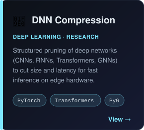
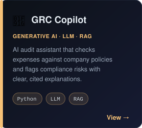
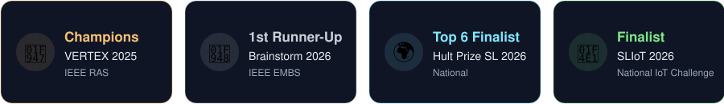

### 👋 Hi, I'm Poorni

I'm a Computer Engineering student who enjoys turning ideas into **working, real-world systems**, from AI models and data pipelines to cloud apps and smart IoT devices.

### 🧩 What I Do

### 🚀 Featured Projects

  
  
  

### 🏆 Achievements

### 🛠️ Tech Stack

  

### 🌳 Commit Garden

  

Every repo grows a branch, every commit grows a leaf 🌸 features bloom · 🍊 fixes glow · refreshed every 6 hours

### 📊 GitHub Activity

  

**Let's build something meaningful together.** &nbsp;🤝

