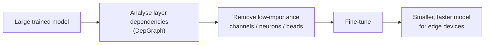

# 🧠 DNN Compression: Structural Pruning of Deep Neural Networks

*Making deep learning models smaller and faster, so they can run on everyday devices.*

---

### 💡 The Problem

Modern AI models are accurate but **large and slow**. That makes them hard to run on phones, drones or embedded boards, where memory, power and speed are limited.

### 🎯 The Idea

**Structural pruning** removes whole parts of a trained network that contribute little, such as entire channels, neurons and attention heads. The model becomes genuinely smaller and faster on real hardware while keeping its accuracy as close as possible to the original.

### 🔬 What I'm Working On

| | |
|---|---|
| 📚 **Study** | DepGraph (CVPR 2023) and the open-source **Torch-Pruning** library |
| 🧪 **Evaluate** | Which architectures it supports: **CNNs, RNNs/LSTMs, Transformers and Graph Neural Networks** |
| 🛠️ **Build** | An automated PyTorch test harness that detects whether pruning **succeeds, crashes, or silently breaks** a model |
| ➕ **Extend** | Add pruning support for under-supported layers such as **LSTM/GRU**, aiming to contribute it to Torch-Pruning |
| 📏 **Compare** | Pruning methods on **accuracy, model size and inference latency** |

### 🛠️ Tech

### 👥 Supervision

Sanka Mohottala (University of Sri Jayewardenepura) · Mr. Asiri Gawesha (SLIIT) · Dr. Dinuka Sahabandu (University of Washington)

---

🔒 *The code is currently private while the research is ongoing. It will be released when the work is complete.*

Interested in this work? **[Get in touch on LinkedIn](https://www.linkedin.com/in/poornipathirage)**

[← Back to profile](https://github.com/poorniGimasha2003)

